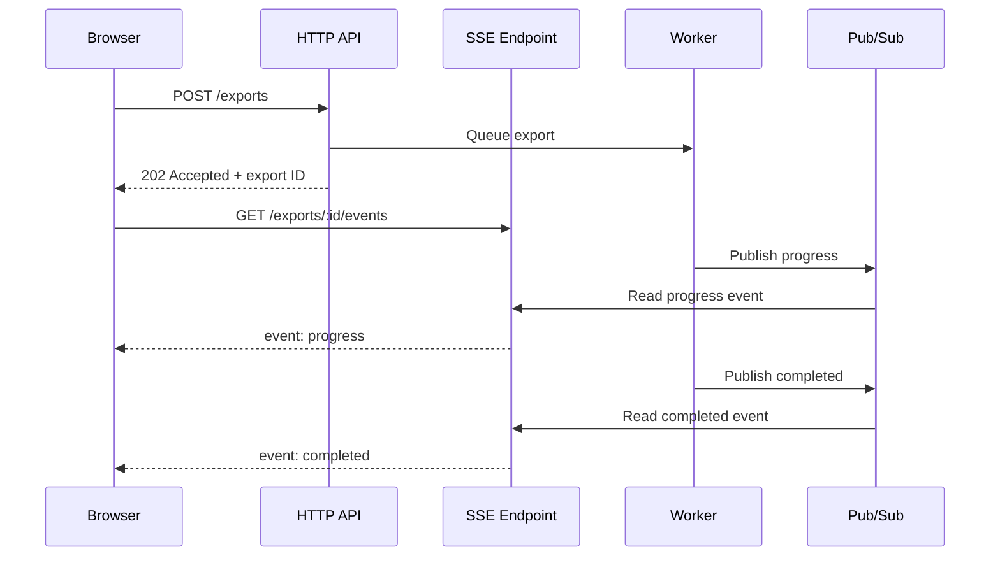
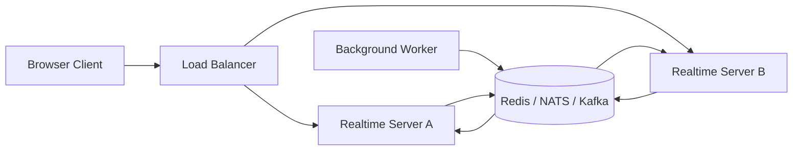

# SSE vs WebSockets: Use One-Way Streaming Until You Need Two-Way Communication

Meta Description: Compare Server-Sent Events and WebSockets in web development, including communication direction, reconnect behavior, browser APIs, scaling, security, and practical use cases.
Main Keyword: SSE vs WebSocket
Source: https://developer.mozilla.org/en-US/docs/Web/API/Server-sent_events

Real-time web features do not all need the same transport.

If a server needs to stream notifications, progress updates, or generated text to a browser, Server-Sent Events (SSE) is often the smaller and more predictable choice. If both sides need to send messages at any time, WebSockets are the better fit.

The wrong choice usually does not fail on day one. It fails later, when reconnects lose events, a reverse proxy buffers the stream, or a team discovers that its “real-time” feature is actually a one-way feed wrapped in a much larger protocol.

## TL;DR: SSE or WebSocket?

- Use **SSE** for one-way, server-to-browser updates over a normal HTTP connection.
- Use **WebSockets** for low-latency, bidirectional communication.
- SSE gives you a browser-managed `EventSource` client with automatic reconnection and event IDs.
- WebSockets support text and binary messages, but you must design reconnection, heartbeats, authentication, and message semantics yourself.
- Neither protocol removes the need for shared state or a pub/sub layer when you have multiple application servers.
- If the browser only listens, start with SSE. Add WebSockets when the client genuinely needs to send real-time messages over the same connection.

## What Is SSE in Web Development?

Server-Sent Events is a browser API and wire format for receiving a continuous stream of text events from a server.

The browser opens a regular HTTP request. The server keeps the response open and writes events as they become available:

```text
HTTP/1.1 200 OK
Content-Type: text/event-stream
Cache-Control: no-cache
Connection: keep-alive

event: progress
id: job-42-7
data: {"completed":70,"total":100}

```

The `EventSource` API parses that format for you. Each event can have a type, an ID, and one or more data lines. The connection is server-to-client only. The browser cannot send application messages back through an `EventSource` connection.

That limitation is not a flaw. It is the reason SSE is a good fit for feeds where the server is the source of truth and the browser is a subscriber.

Typical SSE use cases include:

- live notifications,
- deployment and import progress,
- build logs,
- monitoring dashboards,
- stock or sensor updates,
- AI response streaming,
- background job status,
- activity feeds.

The client can still send commands with ordinary `fetch` requests. For example, a browser can `POST` a new job and then open an SSE stream to watch that job progress. One feature does not have to force every interaction onto one connection.

## What Is a WebSocket?

WebSocket is a protocol for a persistent, full-duplex connection between a client and a server.

The connection begins as an HTTP request and then switches protocols through an upgrade handshake. After the upgrade, either side can send a message at any time without opening another HTTP request.

In the browser, the API looks like this:

```ts
const socket = new WebSocket("wss://example.com/realtime");

socket.addEventListener("open", () => {
  socket.send(JSON.stringify({ type: "subscribe", roomId: "eng" }));
});

socket.addEventListener("message", (event) => {
  const message = JSON.parse(event.data);
  console.log(message);
});

socket.addEventListener("close", () => {
  console.log("Connection closed");
});
```

WebSockets support text and binary messages. That makes them useful when the client also needs to publish frequent messages, such as:

- multiplayer game input,
- collaborative editing operations,
- chat messages,
- cursor and presence updates,
- live auctions,
- device control,
- interactive trading interfaces.

The protocol gives you a transport, not an application contract. You still need to define message types, validation, authorization, ordering, retries, duplicate handling, and what happens when a client reconnects.

## SSE Versus WebSocket: The Practical Differences

The important distinction is communication direction, but the operational differences matter just as much.

| Dimension | SSE | WebSocket |
|---|---|---|
| Communication | Server to client | Client to server and server to client |
| Browser API | `EventSource` | `WebSocket` |
| Transport | HTTP response stream | Upgraded WebSocket connection |
| Data | UTF-8 text events | Text or binary messages |
| Reconnection | Built into `EventSource` | Application code must implement it |
| Event replay | `id` and `Last-Event-ID` can support it | Application protocol must define it |
| Client request headers | Limited with native `EventSource` | Handshake headers are also browser-controlled |
| Proxy compatibility | Usually works as long-lived HTTP | Requires WebSocket upgrade support |
| Best fit | Feeds, notifications, progress, streaming output | Interactive two-way sessions |
| Main cost | One-way and text-only | More protocol and lifecycle work |

SSE is simpler when its constraints match the problem.

WebSockets are more capable when the client needs to participate in the real-time conversation.

## How the Connection Models Differ

Consider a browser watching a long-running image export:



The browser sends a normal HTTP command, then listens to a stream. SSE fits because the progress direction is one-way.

With a WebSocket, the export command and progress updates could share a connection. That is useful if the browser also needs to pause, reprioritize, or cancel the job through the same real-time channel. It is unnecessary complexity if cancellation can be an ordinary `DELETE` request.

## SSE's Biggest Advantage: Less Client Lifecycle Code

The native `EventSource` client reconnects when the connection drops. The server can provide a retry delay and an event ID:

```ts
const events = new EventSource("/api/notifications", {
  withCredentials: true,
});

events.addEventListener("notification", (event) => {
  const notification = JSON.parse(event.data);
  renderNotification(notification);
});

events.addEventListener("error", () => {
  if (events.readyState === EventSource.CLOSED) {
    showOfflineState();
  }
});
```

When an SSE event includes an `id`, the browser can send the last received ID in the `Last-Event-ID` request header after reconnecting. Your server still has to implement replay. It needs a bounded event history or another way to reconstruct the missed state.

Automatic reconnection is helpful, but it is not delivery semantics. A reconnecting client can still miss events if the server has discarded the relevant history. For important updates, make events idempotent and include a way for the client to fetch the current state after reconnecting.

WebSocket clients need to implement the equivalent lifecycle themselves:

1. Open the connection.
2. Authenticate and subscribe.
3. Detect a close or failed connection.
4. Reconnect with backoff and jitter.
5. Re-establish subscriptions.
6. Decide whether messages sent before disconnect need retrying.
7. Recover from missed messages.

This is manageable, and mature libraries can help. It is still application code that your team now owns.

## Where WebSockets Earn Their Complexity

SSE becomes the wrong tool when the client needs to send frequent, low-latency messages.

A browser-based game cannot sensibly send every input through a separate `fetch` request. A collaborative editor should not model every cursor movement as an independent HTTP interaction. A chat application can use SSE for incoming messages, but a bidirectional WebSocket is often a cleaner model when typing indicators, receipts, presence, and messages all travel through the same session.

WebSockets also make binary data possible. That can matter for high-frequency telemetry, audio protocols, or compact custom messages. For ordinary JSON updates, the binary capability is usually not a reason by itself to choose WebSockets.

The key question is not “Which protocol is faster?” It is “Does the client need to send real-time messages, or does it only need to receive them?”

## Reconnection Is Not the Same as Recovery

Both transports run over networks that can disappear. Laptops sleep, mobile connections change, load balancers terminate idle connections, and deploys restart processes.

A connection retry only gets the socket or HTTP stream open again. It does not tell the client what happened while it was away.

Design recovery separately from transport:

- Give meaningful updates stable IDs or sequence numbers.
- Make consumers safe to retry and process twice.
- Keep a short replay window for events that cannot be lost.
- Send a current-state snapshot when replay is no longer possible.
- Expose a normal HTTP endpoint for resynchronization.
- Show connection state in the UI instead of silently pretending everything is current.

For example, an SSE client might reconnect with event ID `1042`. The server can replay events `1043` through `1050`. If `1042` is older than the retention window, the server can send a `reset` event and direct the client to fetch the current document.

WebSocket applications need the same design, usually through an application-level `lastSequence` field in the subscription message.

## Scaling SSE and WebSockets Across Servers

A long-lived connection is attached to one server process, but the event may be produced by another process.

That creates the same scaling problem for both transports. A worker finishes a job on server B, while the browser is connected to server A. Server A needs a way to learn about the update.

The usual architecture adds a shared broker:



The exact broker depends on retention, ordering, throughput, and operational requirements. The architectural point is more stable: do not assume the process holding the connection is also the process producing every event.

Sticky sessions can make some WebSocket deployments easier, but they do not replace shared state. Connections still drop, servers still deploy, and a user can reconnect to a different instance. SSE has the same concern.

Also configure the edge layer intentionally:

- disable response buffering for SSE,
- send `Content-Type: text/event-stream`,
- send periodic comments or heartbeat data if intermediaries close idle streams,
- set connection and request timeouts long enough for the product,
- enable WebSocket upgrades where WebSockets are used,
- verify that authentication and origin headers survive the proxy.

The most common “SSE is broken” bug is a proxy buffering the response until there is enough data to flush. The most common “WebSocket is broken” bug is an ingress that never completed the upgrade.

## Authentication and Security Trade-Offs

Native browser APIs constrain how you authenticate these connections.

`EventSource` does not let you set arbitrary request headers such as `Authorization`. Cookie-based sessions work, including cross-origin cookies when `withCredentials` and the server's CORS policy are configured correctly. Query-string tokens are possible, but they can leak through logs, browser history, and monitoring systems, so treat them carefully.

WebSocket authentication is also commonly cookie-based or performed through a short-lived token during the handshake. The browser's native `WebSocket` constructor does not provide a general-purpose custom-header API either.

For both transports:

- validate the authenticated user on every connection,
- authorize each subscription or channel,
- validate message size and schema,
- check the `Origin` header where appropriate,
- rate-limit connection creation and messages,
- close connections when credentials expire,
- avoid putting secrets in URLs,
- do not trust a client-provided room or user ID.

The persistent connection should not become a persistent authorization decision. Permissions can change while the connection is open.

## Choosing Between SSE and WebSockets

Use SSE when most of these statements are true:

- The server is the only real-time publisher.
- Updates are text or JSON.
- The browser already uses HTTP for commands.
- You want browser-managed reconnection.
- Your infrastructure is optimized for HTTP.
- Event IDs and a replay endpoint are enough for recovery.

Use WebSockets when most of these statements are true:

- Both client and server send messages at unpredictable times.
- The client sends frequent updates.
- You need a single interactive session.
- Binary messages are useful.
- You are prepared to own reconnect and recovery behavior.
- Your load balancer, proxy, observability, and deployment setup support upgrades.

Do not choose WebSockets merely because the feature has the word “live” in its description. A dashboard that receives one update every few seconds is still a one-way stream. SSE is usually easier to reason about there.

Do not choose SSE for a chat or collaborative editor just because it reconnects automatically. You will end up creating a second request path for client messages and then rebuilding session semantics around it.

## A Small Decision Rule

Ask one question:

> Does the browser need to send real-time application messages over this connection?

If the answer is no, use SSE first.

If the answer is yes, use WebSockets when the two-way traffic is central to the feature. Otherwise, keep commands on normal HTTP and use SSE for the server-to-client stream.

That last option is often the sweet spot. HTTP handles request-response work well. SSE handles server-pushed updates well. WebSockets are valuable when the feature actually needs a shared, interactive channel.

## FAQ

## Is SSE faster than WebSockets?

Neither is universally faster. Both can keep a connection open and deliver low-latency updates. WebSockets have lower protocol overhead for some high-frequency bidirectional workloads, while SSE can reach a useful result with less client and infrastructure code. Measure the message rate, payload size, reconnect behavior, and end-to-end latency of your workload.

## Can SSE send data from the browser to the server?

No. `EventSource` is server-to-client. Use `fetch` or regular forms for commands, or use WebSockets when the browser needs to send messages over the persistent connection.

## Does SSE reconnect automatically?

The native `EventSource` API attempts to reconnect after a connection failure. The server can influence the retry delay, and event IDs can help the server resume from the last received event. Your application still needs a replay or resynchronization strategy.

## Are WebSockets suitable for notifications?

They can deliver notifications, but they may be more machinery than necessary if the server is the only publisher. SSE is usually a better starting point for notification feeds, especially when the rest of the application already uses HTTP.

## Can I use SSE and WebSockets in the same application?

Yes. Use each transport for the interaction it models best. For example, an application can use SSE for deployment logs and WebSockets for an interactive terminal. The important part is to keep authentication, authorization, reconnect behavior, and monitoring explicit for each channel.

## Closing

SSE and WebSockets are not competing answers to one generic “real-time” problem.

SSE is an HTTP stream with a useful browser client. WebSockets are a bidirectional message channel with more lifecycle work. Pick SSE for server-pushed updates, and reach for WebSockets when the client must participate in the real-time exchange.

Start with the communication direction, then design recovery and scaling before you write the connection code. That decision will save more time than arguing about protocol benchmarks after production has already started dropping connections.
