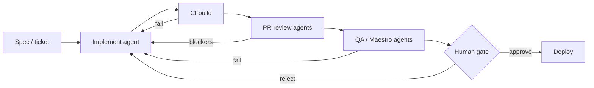

# What Is AI Loop Engineering? Designing Feedback Loops for Coding Agents

Meta Description: AI loop engineering means wiring coding agents into closed build, review, test, and deploy cycles instead of one-off prompts. Here is how I structure those loops on a production H5 frontend codebase.
Main Keyword: AI loop engineering
Published: 2026-10-12
Tags: AI agents, loop engineering, CI/CD, mobile web

Most teams treat AI coding assistants like a faster search bar. You ask a question, copy the answer, move on. That works for snippets. It falls apart the moment you ask an agent to touch a real codebase with CI, reviewers, and mobile end-to-end tests waiting at the end.

The shift that changed how I work was treating AI like infrastructure with **loops**, not like a chat widget. Loop engineering is the practice of designing those closed cycles: build, review, test, fix, deploy, with agents handling bounded steps and humans approving the steps that matter.

## The Problem With One-Shot Agent Prompts

A one-shot prompt has no memory of whether the last output compiled, whether tests passed, or whether anyone read the diff. You get plausible code and you manually close the loop every time.

On a fintech H5 frontend, that manual closing is expensive. Pull requests need review. Mobile web flows need Maestro runs on iOS and Android. Bundle size and LCP regressions show up only after a production build. If the agent never sees that feedback, you become the feedback channel. You re-paste errors, re-explain constraints, and burn context on work the system should automate.

Loop engineering fixes that by making **outcomes** the input to the next agent step.

## What a Closed Loop Looks Like

Here is the loop I run today on my team's primary mobile web codebase. It is not magic. It is explicit wiring.



Each arrow is a machine-readable signal where possible: build logs, review comments, test artifacts, bundle diff summaries. Agents do not guess whether they succeeded. The loop tells them.

The human gate is not decorative. I approve merges, risky dependency bumps, and anything that changes payment-adjacent UI. The agents handle volume. I handle judgment.

## Loop Design Principles That Actually Stick

**1. One agent, one job.** When a single agent implements, reviews, and writes tests in one pass, quality drops and blame gets fuzzy. I split roles: several frontend implementers, a three-agent PR review team, DevOps agents watching pipelines, QA agents for Maestro, plus a solution-architecture doc builder and mention-responder bots for chat. Handoffs are boring YAML and checklists, not prose essays.

**2. Verifiable done criteria beat clever prompts.** Every loop step ends with a pass/fail check: `pnpm build`, lint clean, review policy satisfied, Maestro suite green. Agents get the same contract I would give a junior engineer: scope, constraints, verification command.

**3. Tight feedback latency.** Slow loops train bad habits. If test results take an hour, developers (and agents) batch too much work. I optimize for feedback under fifteen minutes on the paths agents touch most often.

**4. Failures route back to the same owner.** When Maestro fails, the implementer agent gets the trace and screenshot bundle, not a random new session with no file context. Context stickiness matters more than model cleverness.

## A Minimal Loop You Can Ship This Week

You do not need a full agent fleet on day one. Start with a **build-review loop**:

1. Agent opens a branch with a written scope block in the PR description.
2. CI runs build + lint + unit tests.
3. A review agent reads the diff and posts only blocking findings (style nits are ignored by policy).
4. You approve or send one structured fix request.

Once that is reliable, add a test loop: trigger Maestro or Playwright on the PR branch, attach failures to the PR, let the implementer agent iterate until green or until you cap retries.

```md
## Agent task contract
Objective: Fix INP regression on checkout sheet
Scope: apps/checkout/**, packages/ui/Sheet/**
Constraints: No new dependencies; preserve existing analytics events
Done when: build passes, Lighthouse INP < 200ms on lab run, Maestro checkout_smoke green
```

That template is the real product. The model is interchangeable.

## What Loop Engineering Is Not

It is not infinite autonomy. Agents do not merge to production while I sleep without guardrails.

It is not replacing code review with vibes. Review agents are tuned to be **useful, not noisy** (I wrote a separate post on that calibration).

It is not a license to skip specs. Loops fail upstream when the ticket is vague. The architecture doc agent exists partly to force ambiguity out before anyone writes JSX.

## How This Connects to Day-to-Day Efficiency

Loops compound small wins. When an agent already knows the last build failed because of a missing export, you stop re-explaining the repo tree. When review agents enforce bundle boundaries, you catch the 18% page bundle regression class of bugs before humans spend meeting time on it.

The productivity gain is not raw typing speed. It is **fewer round trips through your head** as the integration layer.

## FAQ

### What is AI loop engineering in one sentence?

It is designing development workflows so coding agents receive automated feedback from build, review, and test systems, and iterate until explicit pass/fail criteria are met.

### How is this different from CI/CD?

CI/CD runs pipelines. Loop engineering decides **which agent acts on which signal**, with what context, and when a human must intervene.

### Do I need multiple agents?

No. A single implementer agent plus CI is already a loop. Multiple agents help when review and QA load would otherwise drown one session's context window.

### What should humans always approve?

Merges to shared mainlines, security-sensitive changes, production config, and irreversible data migrations. Everything else can be policy-driven.

## Closing

If you only adopt one idea, adopt verifiable done criteria wired to automated feedback. Run an agent on a real ticket this week, attach CI to the branch, and refuse to merge until the contract passes without you hand-holding the error messages.

That is loop engineering in practice: less prompting theater, more closed cycles that match how shipped software actually gets validated.